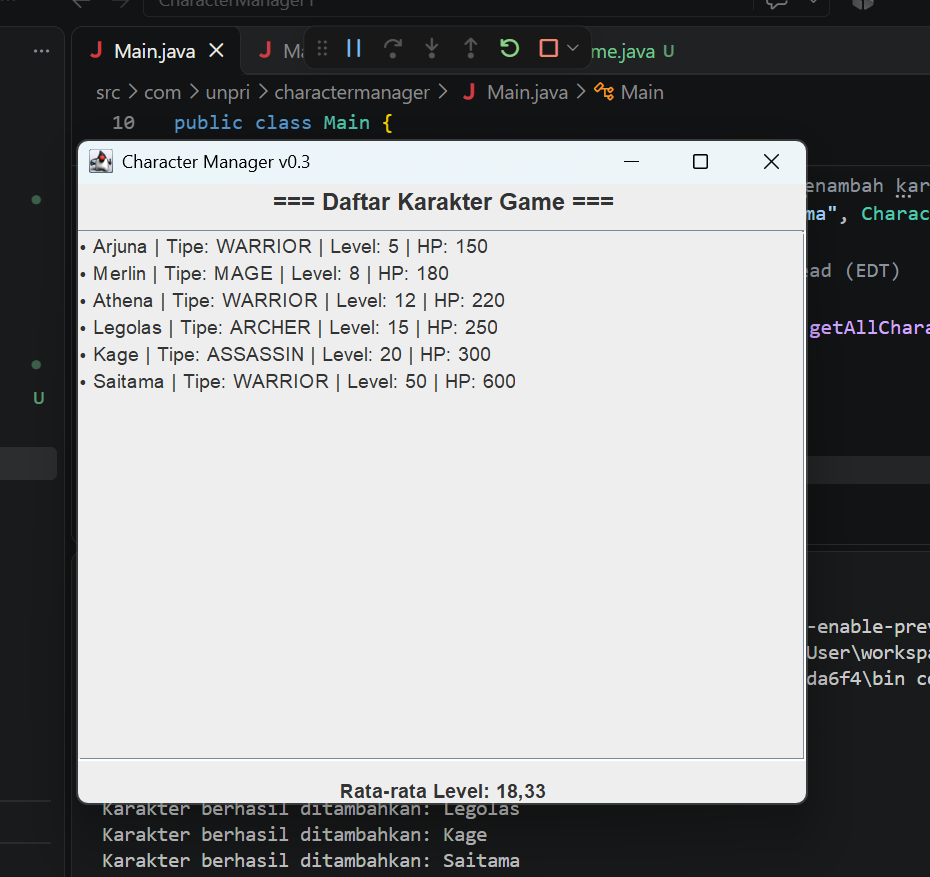
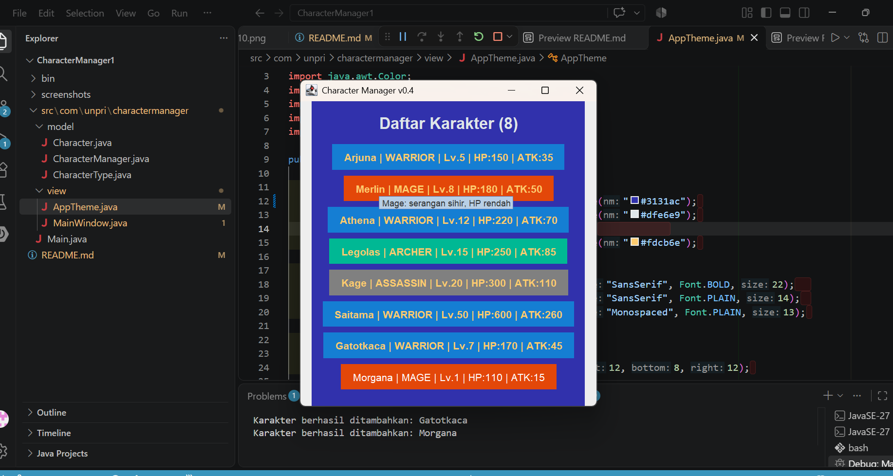

## TP10 — Dokumentasi & Analisis Tampilan (Sprint #4)

### 1. Screenshot Sebelum dan Sesudah
* **Sebelum (v0.3 - Tanpa Tema Terpusat & Highlight):**

* **Sesudah (v0.4 - Dengan AppTheme & Highlight Level Tinggi):**

### 2. Mengapa Warna Disimpan di `AppTheme` dan Bukan di `Character`?
Penyimpanan warna pada kelas `AppTheme` (layer View) dan bukan di dalam kelas `Character` (Model) bertujuan untuk menjaga pemisahan tanggung jawab yang ketat sesuai prinsip arsitektur MVC. Kelas `Character` murni bertugas menyimpan data logika objek (seperti nama, role, dan level), sementara urusan visual dan estetika antarmuka sepenuhnya ditangani oleh komponen View. Pendekatan ini memastikan bahwa perubahan tema warna di masa mendatang dapat dilakukan secara terpusat pada satu file tanpa harus mengubah struktur data inti di dalam model.

### 3. Daftar Dua Properti Tambahan pada Kartu Karakter Beserta Alasannya
1. **Tooltip Dinamis (`setToolTipText`):**
   * *Alasan:* Berfungsi untuk menampilkan informasi deskriptif dan karakteristik khusus setiap role (menggunakan method `AppTheme.describe()`) saat kursor diarahkan ke kartu karakter, sehingga memberikan informasi mendalam secara opsional tanpa membuat layar utama tampak penuh.
2. **Kursor Interaktif (`setCursor`):**
   * *Alasan:* Mengubah bentuk kursor menjadi ikon tangan (*Hand Cursor*) saat menyentuh area kartu karakter, guna memberikan umpan balik visual (*visual feedback*) yang intuitif kepada pengguna bahwa elemen tersebut bersifat interaktif.

### 4. Link Google Docs (Bagian D)
* [Tautan Dokumen Analisis Google Docs](https://docs.google.com/document/d/1Zyd2wV--mXjEFX09lHydEnwldXSQqGZCtSUY-3MU2h4/edit?usp=sharing)