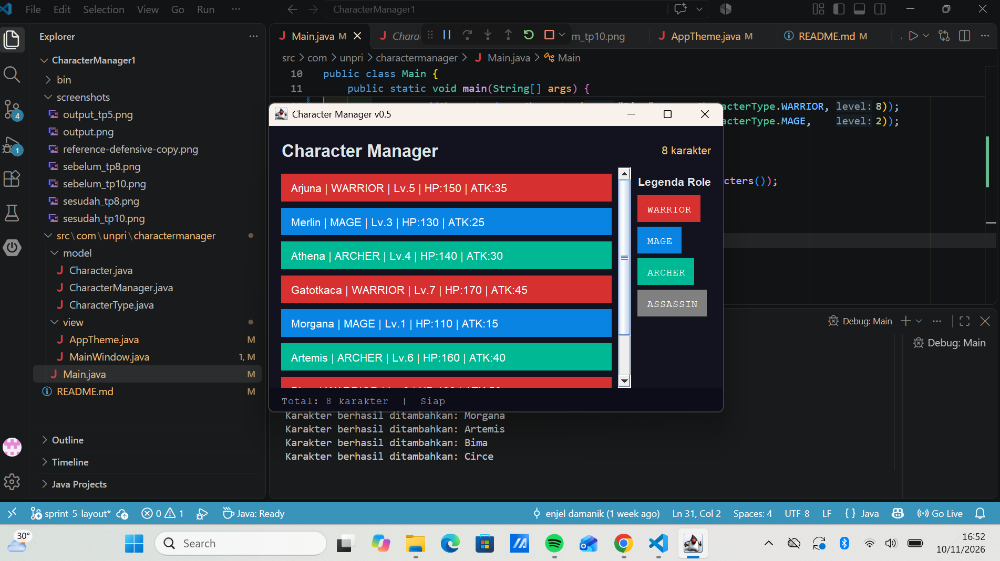
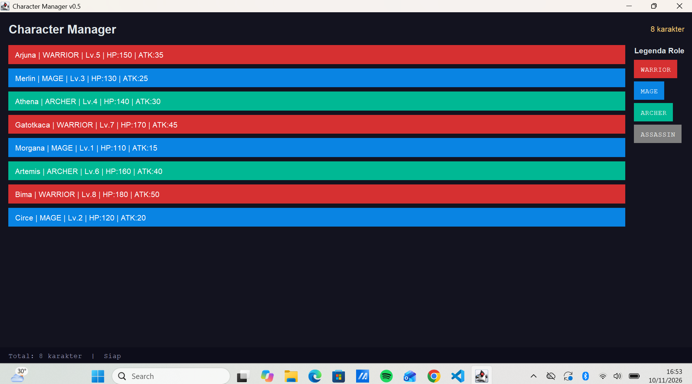
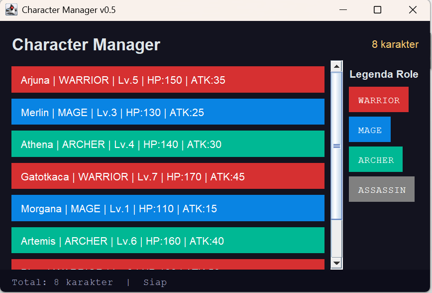

# TP12 — Layout, Resize, dan Dokumentasi GUI

## 1. Wireframe

Berikut wireframe rancangan tampilan Character Manager v0.5:

```text
┌──────────────────────────────────────────────────────────────┐
│ Character Manager                               8 karakter   │
├──────────────────────────────────────────────────────────────┤
│ Total: 8     Warrior: 2     Mage: 2     Archer: 2           │
├───────────────────────────────────────────────────┬──────────┤
│                                                   │          │
│  Arjuna | WARRIOR | Lv.5 | HP | ATK              │ Legenda  │
│                                                   │          │
│  Merlin | MAGE | Lv.3 | HP | ATK                 │ WARRIOR  │
│                                                   │ MAGE     │
│  Athena | ARCHER | Lv.4 | HP | ATK               │ ARCHER   │
│                                                   │ HEALER   │
│  Luna | HEALER | Lv.6 | HP | ATK                 │          │
│                                                   │          │
│  Zeus | WARRIOR | Lv.8 | HP | ATK                │          │
│                                                   │          │
│  Gandalf | MAGE | Lv.7 | HP | ATK                │          │
│                                                   │          │
│  Robin | ARCHER | Lv.2 | HP | ATK                │          │
│                                                   │          │
│  Sakura | HEALER | Lv.5 | HP | ATK               │          │
│                                                   │          │
├───────────────────────────────────────────────────┴──────────┤
│ Total: 8 karakter | Siap                              v0.5 │
└──────────────────────────────────────────────────────────────┘
```

## 2. Screenshot

### Ukuran Awal



Tampilan aplikasi pada ukuran awal setelah program dijalankan.

### Jendela Dilebarkan



Tampilan aplikasi setelah ukuran jendela diperbesar. Area daftar karakter pada bagian `CENTER` mendapatkan ruang lebih besar, sedangkan legenda tetap berada di sebelah kanan.

### Jendela Dikecilkan



Tampilan aplikasi setelah jendela diperkecil sampai scrollbar pada daftar karakter terlihat.

## 3. Tabel Pengamatan Resize

| Kondisi | Prediksi | Hasil |
|---|---|---|
| Ukuran awal | Semua bagian utama terlihat dengan header, daftar karakter, legenda, dan status bar. | Sesuai dengan prediksi. |
| Jendela dilebarkan | Area `CENTER` akan menjadi lebih lebar karena merupakan bagian yang fleksibel pada `BorderLayout`. | Sesuai. Daftar karakter melebar sementara legenda tetap berada di kanan. |
| Jendela dikecilkan | Area daftar karakter menjadi lebih sempit dan scrollbar akan digunakan ketika isi tidak cukup ditampilkan. | Sesuai. Scrollbar vertikal terlihat pada daftar karakter. |

## 4. Struktur Panel Bersarang

Aplikasi menggunakan `BorderLayout` pada `MainWindow` untuk membagi tampilan menjadi bagian `NORTH`, `CENTER`, `EAST`, dan `SOUTH`. Bagian `NORTH` memiliki panel bersarang yang berisi header dan panel statistik tambahan. Bagian `CENTER` menggunakan `JScrollPane` yang membungkus panel daftar kartu karakter, sedangkan bagian `EAST` menggunakan `BoxLayout` untuk menyusun legenda secara vertikal. Struktur panel bersarang ini membuat setiap bagian memiliki tanggung jawab layout yang jelas dan tetap rapi ketika ukuran jendela berubah.

## 5. Alasan Panel Tambahan dan Layout yang Ditolak

Panel statistik ditambahkan untuk menampilkan informasi ringkas mengenai jumlah karakter dan distribusi role. Panel tersebut menggunakan `GridLayout(2, 2)` karena setiap informasi statistik dapat ditempatkan dalam susunan baris dan kolom dengan ukuran yang seragam. Layout yang ditolak adalah `FlowLayout` karena posisi komponen dapat berubah mengikuti lebar ruang yang tersedia sehingga kurang konsisten untuk tampilan statistik. `GridLayout` dipilih karena memberikan susunan yang lebih teratur dan mudah dibaca.

## 6. Link Google Docs — Bagian D

Dokumentasi Bagian D dapat dilihat melalui link berikut:

**[Google Docs Bagian D](https://docs.google.com/document/d/1bsHByR8_pmnIyP6vV8mCfUgSKnN6LbFC94oNbC3o4No/edit?usp=sharing)**