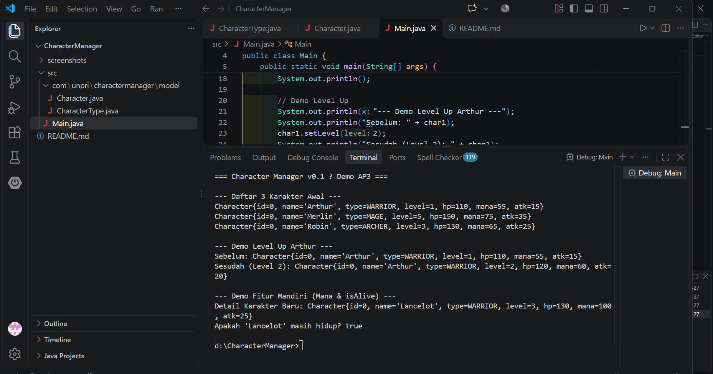
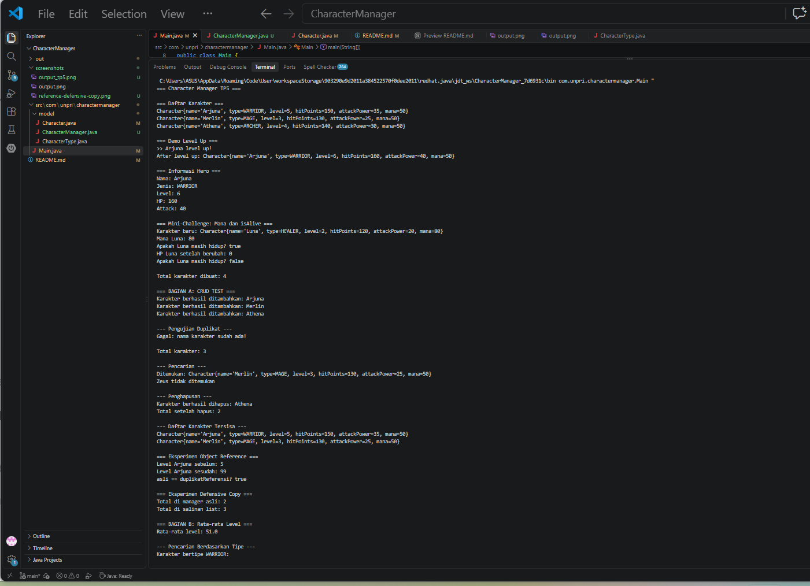
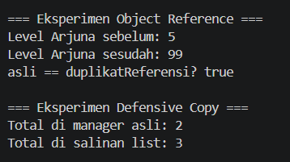
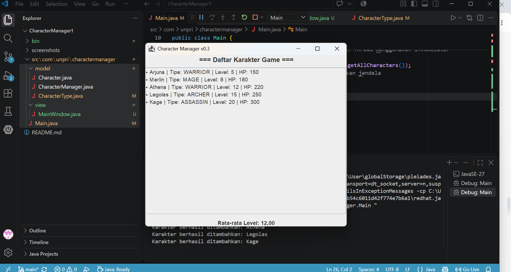
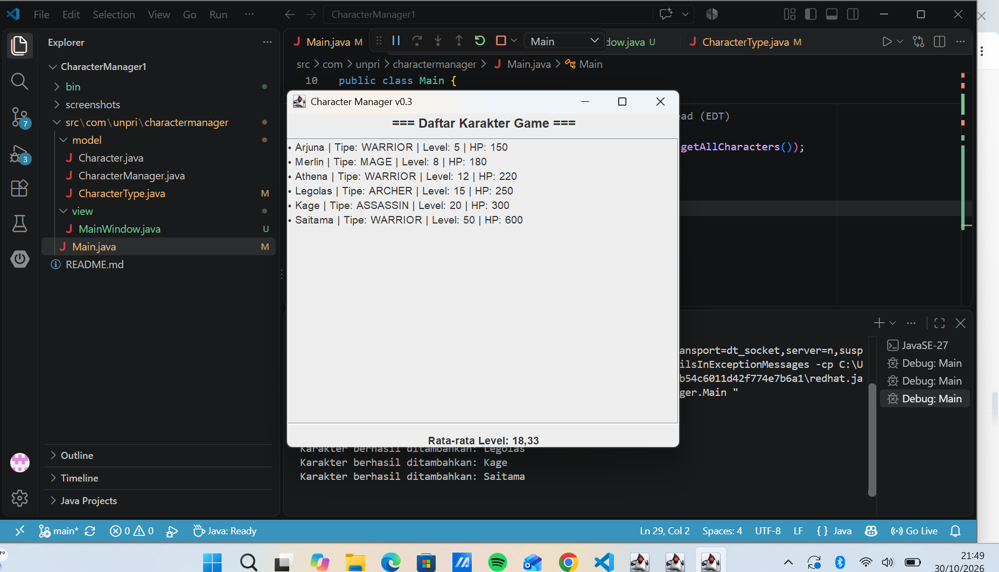

# Character Manager — TP3 (Java Visual SIH-6406)

## Deskripsi

Character Manager merupakan program sederhana berbasis Java untuk mengelola karakter. Program ini menerapkan konsep Object-Oriented Programming (OOP), seperti encapsulation, constructor, dan enum. Program ini memiliki fitur level up, pengelolaan mana, serta pemeriksaan kondisi hidup karakter menggunakan method `isAlive()`.

## Screenshot Output Program

Screenshot berikut menunjukkan hasil eksekusi program, termasuk fitur level up, mana, dan `isAlive()`.



## Struktur Folder Project

```text
CharacterManager/
├── src/
│   └── com/
│       └── unpri/
│           └── charactermanager/
│               ├── Main.java
│               └── model/
│                   ├── Character.java
│                   └── CharacterType.java
├── screenshots/
│   └── output.png
└── README.md
```

## Fitur Program

- Membuat objek karakter menggunakan dua constructor.
- Menentukan jenis karakter menggunakan enum `CharacterType`.
- Menghitung HP dan attack berdasarkan level.
- Menaikkan level karakter menggunakan `setLevel()`.
- Mengatur mana dengan validasi nilai negatif.
- Memeriksa kondisi hidup karakter melalui `isAlive()`.
- Menampilkan data karakter menggunakan `toString()`.

## Identitas Mahasiswa

- Nama lengkap: [Enjel Srimelda Damanik]
- NIM: [253303621267]
- Mata kuliah: Java Visual SIH-6406

## Analisis Desain dan Ekosistem Java

Dokumen Google Docs: [Tempelkan link Google Docs Bagian D di sini] (https://docs.google.com/document/d/1GdGIiooYlFPSR_MY_cIMAgw6LOZMwmrWbYD9XmSj52s/edit?usp=sharing)


# TP5 — Character Manager: Implementasi dan Analisis

## A. Implementasi Core

Pada tugas TP5, project CharacterManager dikembangkan dengan beberapa fitur utama:

1. `addCharacter()` digunakan untuk menambahkan karakter baru ke dalam daftar.
2. `findByName()` digunakan untuk mencari karakter berdasarkan nama.
3. `removeCharacter()` digunakan untuk menghapus karakter.
4. `getTotalCharacters()` digunakan untuk menghitung jumlah karakter.
5. `getAllCharacters()` digunakan untuk mendapatkan salinan daftar karakter.

Penambahan karakter dengan nama duplikat ditolak agar setiap karakter memiliki nama yang unik.

## B. Mini-Challenge

Dua fitur tambahan yang berhasil diimplementasikan:

**1. getAverageLevel()**

Method ini menghitung rata-rata level seluruh karakter. Jika daftar karakter kosong, method mengembalikan nilai 0 agar tidak terjadi pembagian dengan nol.

**2. findByType(CharacterType type)**

Method ini mencari karakter berdasarkan tipe, seperti WARRIOR, MAGE, ARCHER, dan HEALER. Hasil pencarian dikembalikan dalam ArrayList baru.

## C. Fitur Analitik Rancangan Sendiri

**Nama fitur: findStrongest()**

Fitur ini digunakan untuk mencari karakter dengan nilai attack power tertinggi.

Cara kerjanya adalah membandingkan attack power setiap karakter di dalam daftar. Karakter dengan nilai tertinggi akan dikembalikan sebagai hasil.

Fitur ini menjaga encapsulation karena tidak memberikan akses langsung ke ArrayList internal. Jika daftar karakter kosong, method mengembalikan null.

## D. Analisis Reference dan Rancangan
Dokumen analisis Google Docs:
[https://docs.google.com/document/d/1_PTAUrss2dBTFEQFEGuBqRKJbhjbdTM0kX4zpoS-hyU/edit?usp=sharing]

## E. Screenshot Hasil Pengujian
### 1. Output Program TP5

### 2. Eksperimen Object Reference dan Defensive Copy



## TP8

### 1. Screenshot MainWindow
                 (SEBELUM)
  
                (SESUDAH)


### 2. Aliran Data Aplikasi (MVC)
Aliran data diawali dari `Main.java` yang menginstansiasi `CharacterManager` untuk mengelola objek `Character` sebagai representasi layer Model. Selanjutnya, `Main.java` mengambil seluruh daftar karakter melalui metode `manager.getAllCharacters()` dan meneruskannya ke dalam *constructor* `MainWindow`. Komponen `MainWindow` yang bertindak sebagai layer View menerima koleksi data tersebut lalu melakukan iterasi secara dinamis untuk merender daftar karakter serta menghitung statistik rata-rata level pada antarmuka GUI.

### 3. Daftar Karakter Baru
* **Legolas** (Tipe: `ARCHER`, Level: 15): Dipilih dengan tipe `ARCHER` untuk menambahkan variasi kelas *ranged/physical damage* dengan level menengah tinggi.
* **Kage** (Tipe: `ASSASSIN`, Level: 20): Dipilih dengan tipe `ASSASSIN` untuk menguji kelas *stealth/high-burst* serta memberikan nilai level paling tinggi agar korelasi angka rata-rata level terlihat dinamis.

### 4. Tautan Analisis GUI & MVC (Bagian D)
Link Document: (https://docs.google.com/document/d/1NI6IC3iE0PxcyzHzGdWYQRWr3IRLTMnEWTSit2KKvp0/edit?usp=sharing)